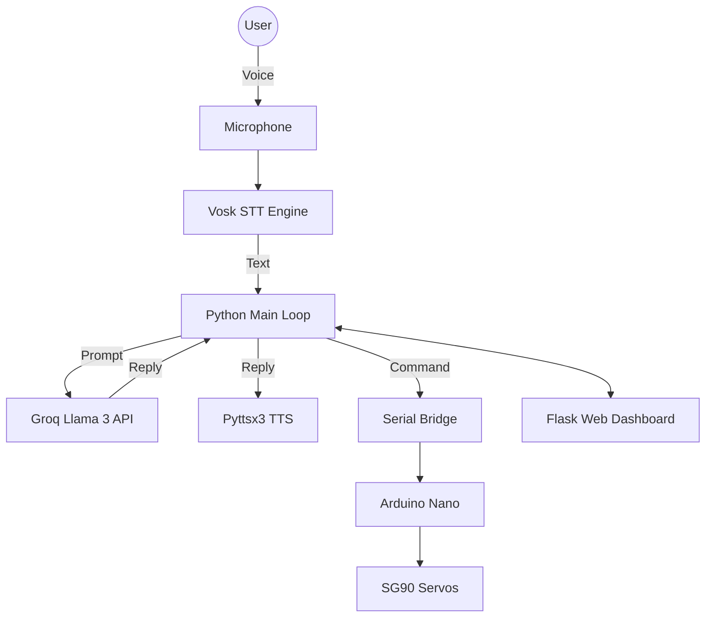

# 🤖 RoboAssistant AI

[](https://www.python.org/)
[](https://www.arduino.cc/)
[](https://groq.com/)
[](https://opensource.org/licenses/MIT)

RoboAssistant AI is a sophisticated, interactive IOT robot that combines hardware motion with cutting-edge Large Language Models. Featuring offline speech recognition, natural language intelligence via Groq, and a 3-DOF articulated body, it serves as a powerful foundation for personal robotics research.

<p align="center">
  
</p>

## 🚀 Key Features

- **🗣️ Natural Voice Interaction:** Uses **Vosk** for high-accuracy, offline speech-to-text.
- **🧠 LLM Intelligence:** Integrated with **Groq (Llama 3 70B)** for lightning-fast, context-aware conversations.
- **🎭 Physical Feedback:** 3 Degrees of Freedom (Head, Left Hand, Right Hand) controlled via an Arduino-Python serial bridge.
- **💻 Live Dashboard:** A Flask-powered web interface for real-time hardware monitoring, state visualization, and manual text input.
- **🔊 Local TTS:** High-performance text-to-speech using `pyttsx3`.
- **🛠️ Robust Reconnection:** Built-in serial error handling and automatic Arduino reconnection logic.

---

## 🛠️ Tech Stack

| Component | Technology |
| :--- | :--- |
| **Main Logic** | Python 3.8+ |
| **Web UI** | Flask, HTML5, CSS3 |
| **AI Backend** | Groq API (Llama 3.3 70B) |
| **STT (Speech)** | Vosk (Offline Model) |
| **TTS (Voice)** | Pyttsx3 |
| **Hardware** | Arduino Uno/Nano, SG90 Servos |
| **Audio Ops** | Pygame Mixer, PyAudio |

---

## 📐 System Architecture



---

## 📦 Installation & Setup

### 1. Prerequisites
- Python 3.8 or higher installed.
- Arduino IDE (for firmware upload).
- Groq API Key ([Get it here](https://console.groq.com/)).

### 2. Clone & Install Dependencies
```bash
# Clone the repository
git clone https://github.com/aminul01-g/IOT_Robot.git
cd IOT_Robot/Integrated

# Install Python requirements
pip install -r requirements.txt
```
*(Note: Ensure you have `pyaudio` and `vosk` installed. On Linux, you may need `libasound-dev` and `portaudio19-dev`.)*

### 3. Setup Hardware
- Connect your Arduino to your computer.
- Open `arduino_sketch/arduino_sketch.ino` in the Arduino IDE.
- Upload the code to your board.
- Note the COM port (e.g., `COM5` or `/dev/ttyUSB0`) and update it in `robot.py` if necessary.

### 4. Vosk Model
Ensure you have a Vosk model in the `Resources` directory:
```bash
# Example: Download small model
# Extract to: Resources/vosk-model-small-en-us-0.15
```

---

## 🚦 Usage

1. **Set your API Key:**
   ```bash
   export GROQ_API_KEY="your_gsk_key_here"
   ```

2. **Start the Robot:**
   ```bash
   python robot.py
   ```

3. **Interact:**
   - **Wake Word:** Say "Robot" or "Robo".
   - **Motion Commands:** 
     - *"Look left"* / *"Look right"*
     - *"Wave your left hand"*
     - *"Say hi"*
   - **Dashboard:** Open `http://127.0.0.1:5000` in your browser to see live state and send text commands.

---

## 🔌 Hardware Wiring

| Servo | Arduino Pin |
| :--- | :--- |
| Left Hand | Pin 8 |
| Head | Pin 9 |
| Right Hand | Pin 10 |

---

## 🤝 Contributing

Contributions are welcome! Please follow these steps:
1. Fork the project.
2. Create your feature branch (`git checkout -b feature/AmazingFeature`).
3. Commit your changes (`git commit -m 'Add some AmazingFeature'`).
4. Push to the branch (`git push origin feature/AmazingFeature`).
5. Open a Pull Request.

---

## 📄 License

Distributed under the MIT License. See `LICENSE` for more information.

---

<p align="center">
  Developed with ❤️ for the Robotics Community.
</p>
